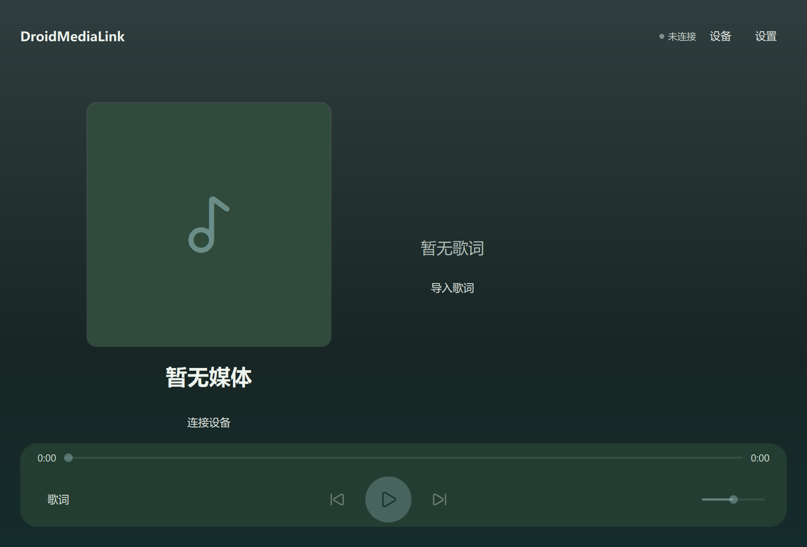
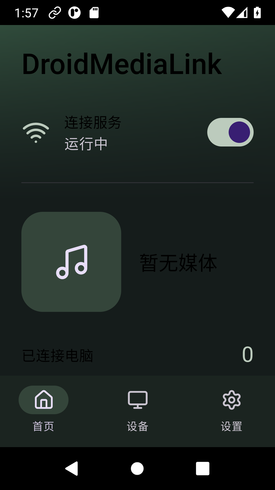

# DroidMediaLink

Bridge Android's current media session to Windows. Audio stays on your phone
and its Bluetooth output. Windows displays metadata, forwards controls, shows
lyrics and publishes native system media controls; no audio is streamed.

The product name is **DroidMediaLink**; the existing repository is
`git@github.com:XHZ-Steve/DroidMusicLink.git`. These identify the same project.
Android's stable application ID is `org.droidmedialink.android`.

1. Install the Android test-signed APK, grant notification-listener access and
   notification permission, then start the service.
2. On the same LAN, click Search devices in Windows and select the phone name.
3. Compare the numbers on both screens and confirm on the phone. No address,
   fingerprint or code entry is needed. Trusted devices reconnect automatically.
4. Play in your existing phone music app. Available controls follow its actual
   standard MediaSession capabilities.

Android passively listens; Windows discovers, authenticates and reconnects.
Pairing requires local phone approval and can be revoked. Do not forward the
phone listener port onto the public internet.

The stack is C++20/Qt Quick/Win32/C++WinRT on Windows and Kotlin/Compose
Material 3 on Android (minimum API 26, target 36). Windows 11 x64 is the main
target; Windows 10 material effects degrade. See [build instructions](docs/build-and-release.md),
[protocol](protocol/README.md), [test records](docs/testing.md),
[privacy](docs/privacy.md), and [limitations](docs/known-limitations.md).

Local build outputs go to ignored `artifacts/`. CI uploads test artifacts and
does not publish releases. No production signing key is supplied: APKs are
test-signed and Windows packages lack Authenticode. Implementation, compilation,
automated checks and real-device verification are distinct; consult test records.

Missing media usually requires notification-listener authorization or a player
that exposes MediaSession. Discovery may fail on isolated Wi-Fi networks; use
manual addressing. Certificate changes require fingerprint verification and
re-pairing. Android may stop background services; manual restoration can be
necessary. Local LRC/TTML import is available; optional LRCLIB results may not
match a particular recording.

Project source is [MIT](LICENSE); dependencies retain their own licenses. Read
[third-party notices](THIRD_PARTY_NOTICES.md).

[简体中文](README.md)
