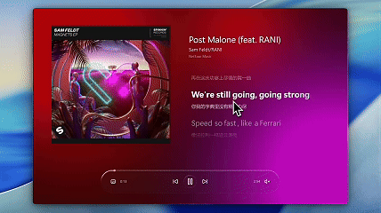
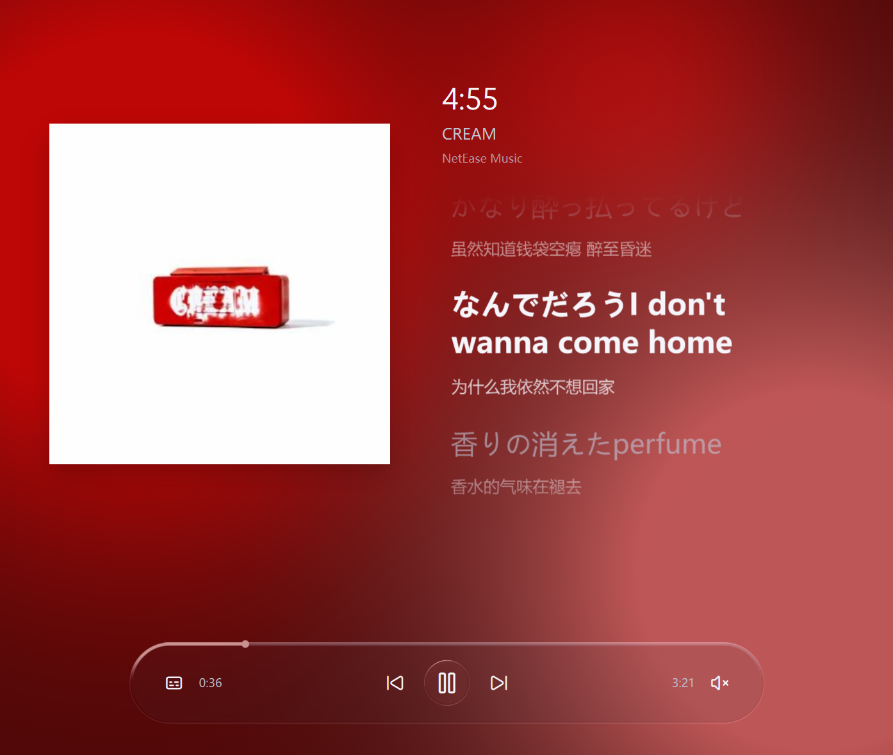
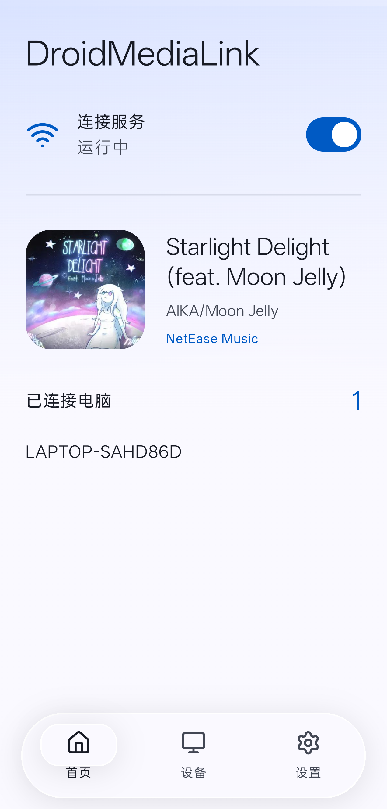

# DroidMediaLink

[Download v1.0](https://github.com/XHZ-Steve/DroidMusicLink/releases/tag/v1.0) · [简体中文](README.md) · [Build instructions](docs/build-and-release.md) · [CI builds](https://github.com/XHZ-Steve/DroidMusicLink/actions)

Bring your Android media session to Windows: artwork, playback controls, synchronized lyrics and Windows system media controls. Audio stays on your phone and its headphones; this is not an audio-streaming application.

## Running on real devices

These are actual application captures taken at different times, not mockups or preview media.

## Features

- LAN discovery, explicit matching-number authorization, saved pairing and reconnection.
- Playback, seeking, volume and capability-dependent favorite controls.
- Windows SMTC artwork, tray menu, floating player and always-on-top desktop lyrics.
- Local and online lyrics, player-published phone lyrics, word/line timing and cross-source translation supplementation.
- Cover-derived ambient colors, optional Liquid Glass, capsule progress and water-glass playback controls.
- Chinese and English, persistent preferences and settings import/export.

UI state updates pause during native window/component dragging and catch up on release; connection heartbeats continue. Factory appearance preferences reflect the maintainer's actual configuration without credentials, addresses or paired identities.

## Get started

1. Download the Windows installer/portable package and Android APK from [v1.0 Release](https://github.com/XHZ-Steve/DroidMusicLink/releases/tag/v1.0). Extract the complete Windows portable archive.
2. Install the Android APK, complete permission onboarding and enable the connection service.
3. Put both devices on the same LAN. Find your phone in Windows Settings → Devices and connection, compare the numbers, and approve on the phone.
4. Play music in your existing Android player. Control it from Windows; use the tray to reopen the main window.

Android listens passively; Windows discovers and connects. No manual address or certificate input is required. Do not expose the service to the public internet.

## Build and compatibility

Windows: C++20, Qt Quick/QML and Win32/C++/WinRT, primarily Windows 11 x64. Android: Kotlin, Compose Material 3, Android 8.0/API 26 or newer.

Player capabilities vary. Full phone lyrics and favorites require player-published interfaces. Online lyric providers may fail and fall back. APKs use development signing; Windows packages are not Authenticode-signed. CI uploads artifacts and does not automatically publish releases.

See [build instructions](docs/build-and-release.md), [testing](docs/testing.md), [protocol](protocol/README.md), [privacy](docs/privacy.md), [known limitations](docs/known-limitations.md) and [third-party licenses](THIRD_PARTY_NOTICES.md).

Product: **DroidMediaLink**. Repository: **DroidMusicLink**. Local build outputs live in `artifacts/` and are excluded from Git. See [LICENSE](LICENSE) for the project license.
