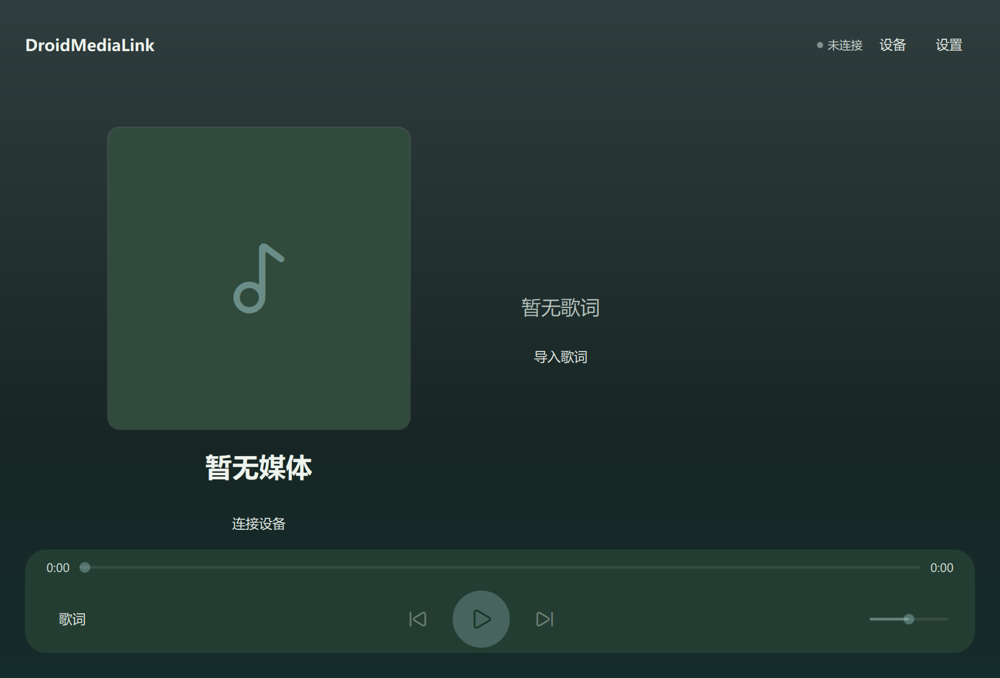
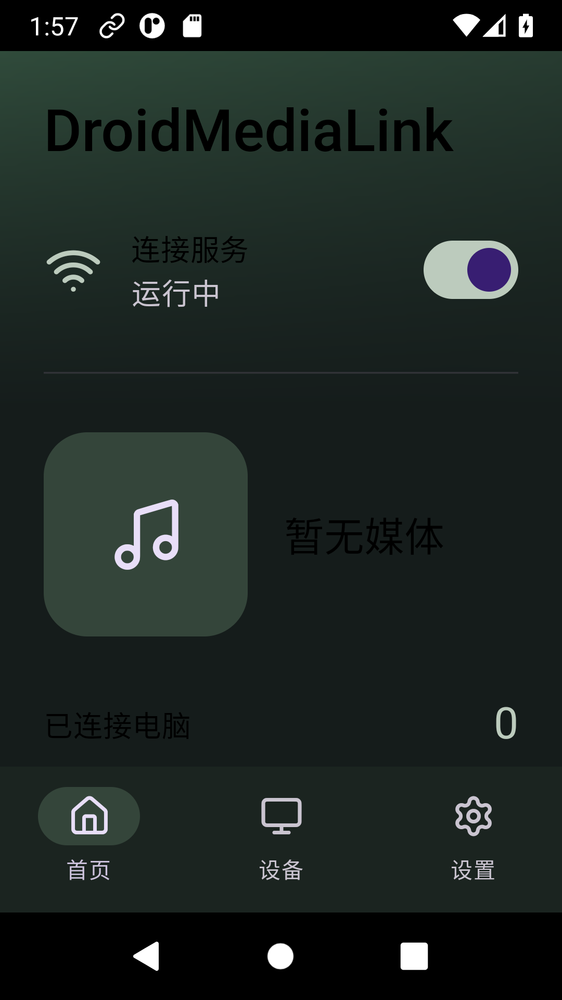

# DroidMediaLink

把 Android 当前媒体会话连接到 Windows。手机与蓝牙耳机照常播放；电脑显示歌曲、远程控制、歌词和 Windows 系统媒体控件，不传输音频。

产品名为 **DroidMediaLink**，仓库地址为 `git@github.com:XHZ-Steve/DroidMusicLink.git`，两者指同一项目。Android 包名固定为 `org.droidmedialink.android`，Windows 应用标识为 `DroidMediaLink.Desktop`。

## 运行

1. Android 安装测试签名 APK，授予通知使用权和通知权限，启动服务。
2. 两端位于同一局域网；Windows 点击“搜索设备”，选择手机名称。
3. 核对电脑和手机显示的相同数字，在手机点击“数字一致，连接”。之后自动重连，无需填写地址、指纹或配对码。
4. 在手机原有音乐 App 播放。电脑的可用控制以该 App 的真实 MediaSession 能力为准。

Android 保持被动监听；Windows 主动发现、认证和重连。首次配对需要手机操作，授权可撤销。不要把手机端口转发到公网。

## 构建与验证

Windows：C++20、Qt 6 Quick/QML、Win32/C++/WinRT；Android：Kotlin、Compose Material 3，最低 Android 8.0/API 26，target 36。Windows 11 x64 是主目标；Windows 10 系统材质降级。

参见[构建与打包](docs/build-and-release.md)、[协议](protocol/README.md)、[测试记录与矩阵](docs/testing.md)、[架构](docs/architecture.md)、[隐私](docs/privacy.md)、[已知限制](docs/known-limitations.md)。本地产物写入未纳入 Git 的 `artifacts/`。GitHub Actions 会构建并保留测试产物，不自动发布 Release。

没有生产签名密钥：APK 使用测试签名，Windows 包未做 Authenticode。源码实现、构建通过和实际设备验证是不同状态；以测试记录为准。

## 权限与常见问题

- 没有媒体：检查通知使用权、播放器是否发布标准 MediaSession。
- 找不到手机：检查同一网络、AP 客户端隔离、手机服务状态；确认手机服务已启动，重新搜索。
- 设备身份变化：两端重新显示确认码，核对相同后在手机确认。
- 服务停止：Android 后台限制和厂商策略可能需要手动恢复；不承诺永久驻留。
- 没有歌词：可导入本地 LRC/TTML，在线歌词为可选 LRCLIB 请求，匹配结果不保证准确。

外观可选标准或液态玻璃。桌面采用 shayann07/liquidglass Qt 材质层，Android 采用 Kyant0/AndroidLiquidGlass 对应的 Backdrop；实际折射分别已在 Windows D3D11 和 Android API33 运行验证，旧系统保留标准控件样式。

项目采用 [MIT](LICENSE)；Qt 与其他依赖保留各自许可，详见[第三方声明](THIRD_PARTY_NOTICES.md)。

[English](README.en.md)
